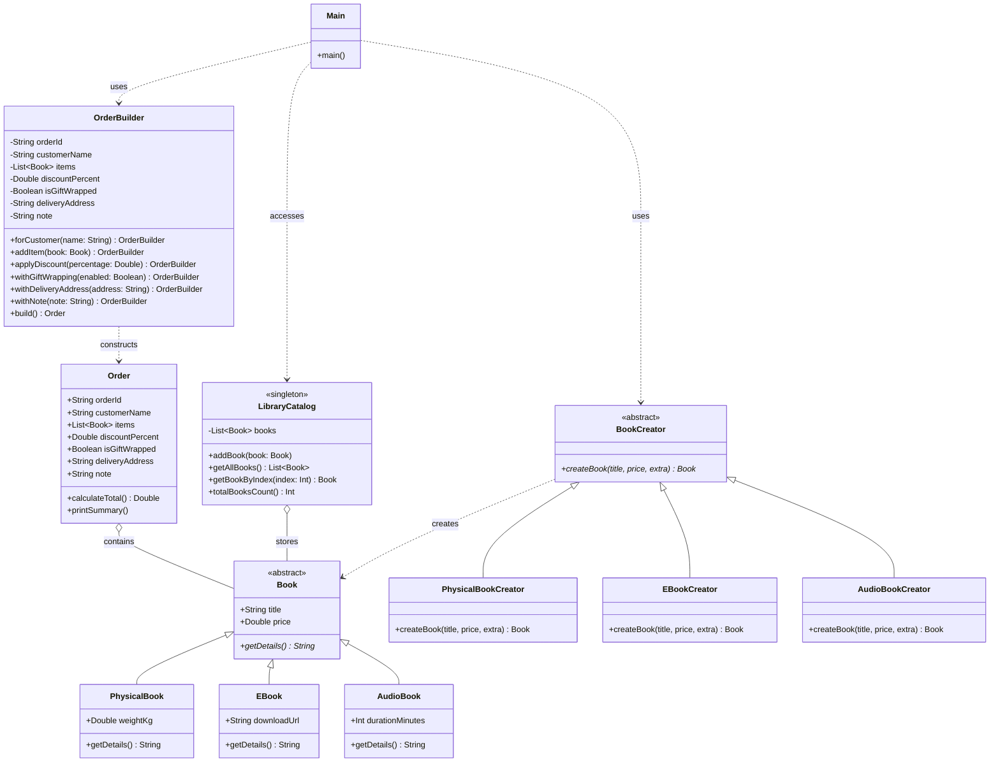

# Laboratory Work 2: Creational Design Patterns

## 1. Introduction

This laboratory work continues building upon the **Online Bookstore & Library System** introduced in the first lab. While Lab 1 established core object-oriented principles, this lab focuses on object creation mechanisms through **Creational Design Patterns**. 

Creational patterns abstract the instantiation process, making systems independent of how their objects are created, composed, and represented. In this lab, three creational patterns are implemented:

1. **Factory Method** (`BookFactory.kt`): Decouples client code from concrete book representations (`PhysicalBook`, `EBook`, `AudioBook`) by delegating instantiation to specialized creator subclasses.
2. **Builder** (`OrderBuilder.kt`): Separates the construction of a complex `Order` object from its representation, allowing step-by-step configuration with optional parameters like discounts, gift wrapping, and delivery options.
3. **Singleton** (`LibraryCatalog.kt`): Ensures a single, globally accessible, thread-safe instance representing the library's in-memory catalog and inventory.

The application aggregates all three patterns into an interactive terminal menu in `Main.kt`.

---

## 2. UML Architecture Diagram

The following class diagram illustrates the architecture of the system, showing the relationships between products, creators, builders, and the singleton catalog:



---

## 3. Implementation of Creational Patterns

### 3.1 Factory Method Pattern (`BookFactory.kt`)
**Purpose:** Defines an interface or abstract class for creating an object, but lets subclasses decide which class to instantiate.

In a bookstore, books come in diverse formats requiring distinct metadata (e.g. shipping weight for physical books, download links for e-books, runtime duration for audiobooks). Instead of scattering `when` or `if-else` constructors throughout the UI, `BookFactory.kt` introduces:
- Abstract product `Book` and concrete variants: `PhysicalBook`, `EBook`, `AudioBook`.
- Abstract creator `BookCreator` with abstract method `createBook(title, price, extra)`.
- Concrete creators: `PhysicalBookCreator`, `EBookCreator`, and `AudioBookCreator`.

```kotlin
abstract class Book(
    val title: String,
    val price: Double
) {
    abstract fun getDetails(): String
}

class PhysicalBook(
    title: String,
    price: Double,
    val weightKg: Double
) : Book(title, price) {
    override fun getDetails(): String = "$title (Physical, ${weightKg}kg) - $${"%.2f".format(price)}"
}

class EBook(
    title: String,
    price: Double,
    val downloadUrl: String
) : Book(title, price) {
    override fun getDetails(): String = "$title (E-Book) - $${"%.2f".format(price)}"
}

class AudioBook(
    title: String,
    price: Double,
    val durationMinutes: Int
) : Book(title, price) {
    override fun getDetails(): String = "$title (Audiobook, ${durationMinutes} mins) - $${"%.2f".format(price)}"
}

abstract class BookCreator {
    abstract fun createBook(title: String, price: Double, extra: String): Book
}

class PhysicalBookCreator : BookCreator() {
    override fun createBook(title: String, price: Double, extra: String): Book {
        val weight = extra.toDoubleOrNull() ?: 0.5
        return PhysicalBook(title, price, weight)
    }
}

class EBookCreator : BookCreator() {
    override fun createBook(title: String, price: Double, extra: String): Book {
        val url = if (extra.isBlank()) "https://books.example/download" else extra
        return EBook(title, price, url)
    }
}

class AudioBookCreator : BookCreator() {
    override fun createBook(title: String, price: Double, extra: String): Book {
        val duration = extra.toIntOrNull() ?: 60
        return AudioBook(title, price, duration)
    }
}
```

---

### 3.2 Builder Pattern (`OrderBuilder.kt`)
**Purpose:** Separates the construction of a complex object from its final representation, avoiding "telescoping constructor" anti-patterns.

An `Order` contains multiple properties: customer name, a collection of books, optional percentage discounts, optional gift wrapping, optional home delivery with an address, and optional customer notes. 

`OrderBuilder` provides a clear, fluent API to incrementally configure only the needed attributes, performs validation (ensuring at least one book exists), and produces an immutable `Order` instance.

```kotlin
class Order(
    val orderId: String,
    val customerName: String,
    val items: List<Book>,
    val discountPercent: Double,
    val isGiftWrapped: Boolean,
    val deliveryAddress: String?,
    val note: String?
) {
    fun calculateTotal(): Double {
        val subtotal = items.sumOf { it.price }
        val discounted = subtotal * (1.0 - discountPercent / 100.0)
        val giftCost = if (isGiftWrapped) 5.0 else 0.0
        val shippingCost = if (deliveryAddress != null) 10.0 else 0.0
        return discounted + giftCost + shippingCost
    }

    fun printSummary() {
        println("=== Order Summary (#$orderId) ===")
        println("Customer: $customerName")
        println("Items:")
        items.forEachIndexed { idx, book ->
            println("  ${idx + 1}. ${book.getDetails()}")
        }
        val subtotal = items.sumOf { it.price }
        println("Subtotal: $${"%.2f".format(subtotal)}")
        if (discountPercent > 0) println("Discount: ${discountPercent.toInt()}%")
        if (isGiftWrapped) println("Gift Wrapping: Yes (+$5.00)")
        if (deliveryAddress != null) {
            println("Delivery Address: $deliveryAddress (+$10.00)")
        } else {
            println("Delivery: Store Pickup (Free)")
        }
        note?.let { println("Note: $it") }
        println("Total Amount: $${"%.2f".format(calculateTotal())}")
        println("=================================")
    }
}

class OrderBuilder(private val orderId: String) {
    private var customerName: String = "Guest"
    private val items = mutableListOf<Book>()
    private var discountPercent: Double = 0.0
    private var isGiftWrapped: Boolean = false
    private var deliveryAddress: String? = null
    private var note: String? = null

    fun forCustomer(name: String): OrderBuilder {
        this.customerName = name
        return this
    }

    fun addItem(book: Book): OrderBuilder {
        this.items.add(book)
        return this
    }

    fun applyDiscount(percentage: Double): OrderBuilder {
        this.discountPercent = percentage
        return this
    }

    fun withGiftWrapping(enabled: Boolean): OrderBuilder {
        this.isGiftWrapped = enabled
        return this
    }

    fun withDeliveryAddress(address: String?): OrderBuilder {
        this.deliveryAddress = address
        return this
    }

    fun withNote(note: String?): OrderBuilder {
        this.note = note
        return this
    }

    fun build(): Order {
        require(items.isNotEmpty()) { "Order must contain at least one book." }
        return Order(
            orderId = orderId,
            customerName = customerName,
            items = items.toList(),
            discountPercent = discountPercent,
            isGiftWrapped = isGiftWrapped,
            deliveryAddress = deliveryAddress,
            note = note
        )
    }
}
```

---

### 3.3 Singleton Pattern (`LibraryCatalog.kt`)
**Purpose:** Ensures that a class has only one instance and provides a global point of access to it.

The bookstore inventory must remain unified and consistent across all screens and order operations. In Kotlin, `object LibraryCatalog` compiles into a thread-safe, lazily initialized singleton:
- Internal list `books` is marked `private` to safeguard encapsulation.
- Read-only getters like `getAllBooks()` return immutable list copies to prevent external mutations.
- Accessible everywhere as `LibraryCatalog`.

```kotlin
object LibraryCatalog {
    private val books = mutableListOf<Book>()

    init {
        books.add(PhysicalBook("Clean Code", 35.0, 0.6))
        books.add(EBook("Kotlin in Action", 30.0, "https://books.example/kotlin"))
        books.add(AudioBook("The Pragmatic Programmer", 45.0, 360))
    }

    fun addBook(book: Book) {
        books.add(book)
    }

    fun getAllBooks(): List<Book> = books.toList()

    fun getBookByIndex(index: Int): Book? {
        return if (index in books.indices) books[index] else null
    }

    fun totalBooksCount(): Int = books.size
}
```

---

### 3.4 Aggregation in `Main.kt`

`Main.kt` brings the three creational patterns together into an interactive menu:
1. **View Catalog (Singleton)**: Queries `LibraryCatalog.getAllBooks()`.
2. **Add Book (Factory Method)**: Asks the user for book details and uses `PhysicalBookCreator`, `EBookCreator`, or `AudioBookCreator` to create the item before appending it to `LibraryCatalog`.
3. **Create Order (Builder)**: Uses `OrderBuilder` to pick books from the singleton catalog, set discounts, toggle gift wrapping, set home delivery, and print the order summary.

```kotlin
fun main() {
    val scanner = Scanner(System.`in`)
    var orderCounter = 1

    println("=== Bookstore & Library Management (Lab 2: Creational Patterns) ===")

    while (true) {
        println("\nMenu:")
        println("1. View all books in catalog (Singleton)")
        println("2. Add a new book (Factory Method)")
        println("3. Create a custom order (Builder)")
        println("4. Exit")
        print("Choose an option: ")

        when (scanner.nextLine().trim()) {
            "1" -> {
                val books = LibraryCatalog.getAllBooks()
                println("\n=== Catalog Inventory (${LibraryCatalog.totalBooksCount()} books) ===")
                books.forEachIndexed { idx, book -> println("${idx + 1}. ${book.getDetails()}") }
                println("==========================================")
            }
            "2" -> {
                print("Enter title: ")
                val title = scanner.nextLine().trim()
                print("Enter price: ")
                val price = scanner.nextLine().trim().toDoubleOrNull() ?: 0.0

                println("Select book format:\n1. Physical Book\n2. E-Book\n3. Audiobook")
                print("Choice: ")

                val (creator: BookCreator, extraPrompt: String) = when (scanner.nextLine().trim()) {
                    "2" -> Pair(EBookCreator(), "Enter download URL: ")
                    "3" -> Pair(AudioBookCreator(), "Enter duration in minutes: ")
                    else -> Pair(PhysicalBookCreator(), "Enter weight in kg: ")
                }

                print(extraPrompt)
                val extra = scanner.nextLine().trim()
                val createdBook = creator.createBook(title, price, extra)
                LibraryCatalog.addBook(createdBook)
                println("Created and added: ${createdBook.getDetails()}")
            }
            "3" -> {
                val books = LibraryCatalog.getAllBooks()
                val orderId = "ORD-${"%03d".format(orderCounter++)}"
                val builder = OrderBuilder(orderId)

                print("Enter customer name: ")
                val name = scanner.nextLine().trim()
                if (name.isNotBlank()) builder.forCustomer(name)

                println("\nAvailable books:")
                books.forEachIndexed { idx, book -> println("${idx + 1}. ${book.getDetails()}") }
                print("Enter book numbers to add (comma-separated, e.g. 1, 2): ")
                val selections = scanner.nextLine().trim()
                val selectedIndices = selections.split(",").mapNotNull { it.trim().toIntOrNull() }.map { it - 1 }

                for (idx in selectedIndices) {
                    val book = LibraryCatalog.getBookByIndex(idx)
                    if (book != null) builder.addItem(book)
                }

                print("Enter discount percentage (0-50, or hit Enter for 0): ")
                val discount = scanner.nextLine().trim().toDoubleOrNull() ?: 0.0
                builder.applyDiscount(discount)

                print("Include gift wrapping? (y/N): ")
                val isGift = scanner.nextLine().trim().equals("y", ignoreCase = true)
                builder.withGiftWrapping(isGift)

                print("Require home delivery? (y/N): ")
                val isDelivery = scanner.nextLine().trim().equals("y", ignoreCase = true)
                if (isDelivery) {
                    print("Enter delivery address: ")
                    builder.withDeliveryAddress(scanner.nextLine().trim())
                }

                print("Add a custom note (optional): ")
                val note = scanner.nextLine().trim()
                if (note.isNotBlank()) builder.withNote(note)

                val order = builder.build()
                println()
                order.printSummary()
            }
            "4" -> {
                println("Exiting system. Goodbye!")
                break
            }
            else -> println("Invalid option. Please choose 1, 2, 3, or 4.")
        }
    }
}
```

---

### 3.5 Execution Output

```text
=== Bookstore & Library Management (Lab 2: Creational Patterns) ===

Menu:
1. View all books in catalog (Singleton)
2. Add a new book (Factory Method)
3. Create a custom order (Builder)
4. Exit
Choose an option: 1

=== Catalog Inventory (3 books) ===
1. Clean Code (Physical, 0.6kg) - $35.00
2. Kotlin in Action (E-Book) - $30.00
3. The Pragmatic Programmer (Audiobook, 360 mins) - $45.00
==========================================

Menu:
1. View all books in catalog (Singleton)
2. Add a new book (Factory Method)
3. Create a custom order (Builder)
4. Exit
Choose an option: 2
Enter title: Design Patterns
Enter price: 50.0
Select book format:
1. Physical Book
2. E-Book
3. Audiobook
Choice: 3
Enter duration in minutes: 480
Created and added: Design Patterns (Audiobook, 480 mins) - $50.00

Menu:
1. View all books in catalog (Singleton)
2. Add a new book (Factory Method)
3. Create a custom order (Builder)
4. Exit
Choose an option: 3
Enter customer name: Alice Smith

Available books:
1. Clean Code (Physical, 0.6kg) - $35.00
2. Kotlin in Action (E-Book) - $30.00
3. The Pragmatic Programmer (Audiobook, 360 mins) - $45.00
4. Design Patterns (Audiobook, 480 mins) - $50.00
Enter book numbers to add (comma-separated, e.g. 1, 2): 1, 4
Enter discount percentage (0-50, or hit Enter for 0): 10
Include gift wrapping? (y/N): y
Require home delivery? (y/N): y
Enter delivery address: Baker Street 221B
Add a custom note (optional, hit Enter to skip): Please leave at the front door

=== Order Summary (#ORD-001) ===
Customer: Alice Smith
Items:
  1. Clean Code (Physical, 0.6kg) - $35.00
  2. Design Patterns (Audiobook, 480 mins) - $50.00
Subtotal: $85.00
Discount: 10%
Gift Wrapping: Yes (+$5.00)
Delivery Address: Baker Street 221B (+$10.00)
Note: Please leave at the front door
Total Amount: $91.50
=================================

Menu:
1. View all books in catalog (Singleton)
2. Add a new book (Factory Method)
3. Create a custom order (Builder)
4. Exit
Choose an option: 4
Exiting system. Goodbye!
```

---

## 4. Conclusion

In this laboratory work, three creational design patterns were implemented to address distinct object instantiation requirements in the Bookstore System:
- **Factory Method** isolated product variations (`PhysicalBook`, `EBook`, `AudioBook`) behind concrete creators, making adding new media types seamless without touching UI or processing code.
- **Builder** provided a clean, readable, and flexible mechanism to construct multi-option `Order` objects without unwieldy constructors.
- **Singleton** enforced a centralized, thread-safe inventory repository via Kotlin's native `object` construct.

These patterns keep the architecture clean, maintainable, and well-prepared for subsequent labs covering structural and behavioral design patterns.
