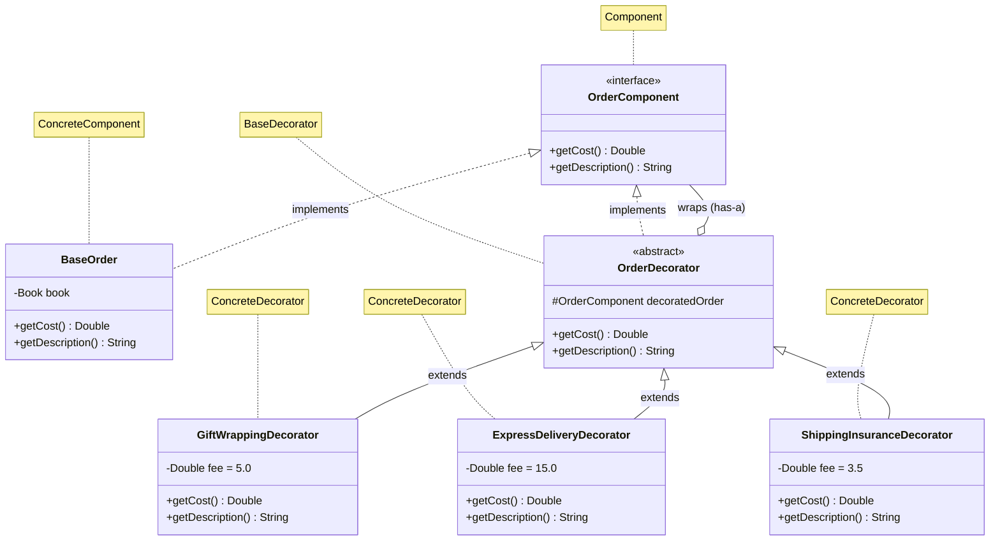
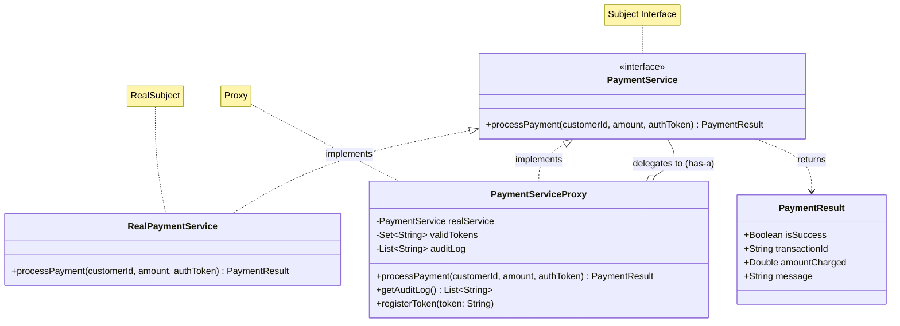
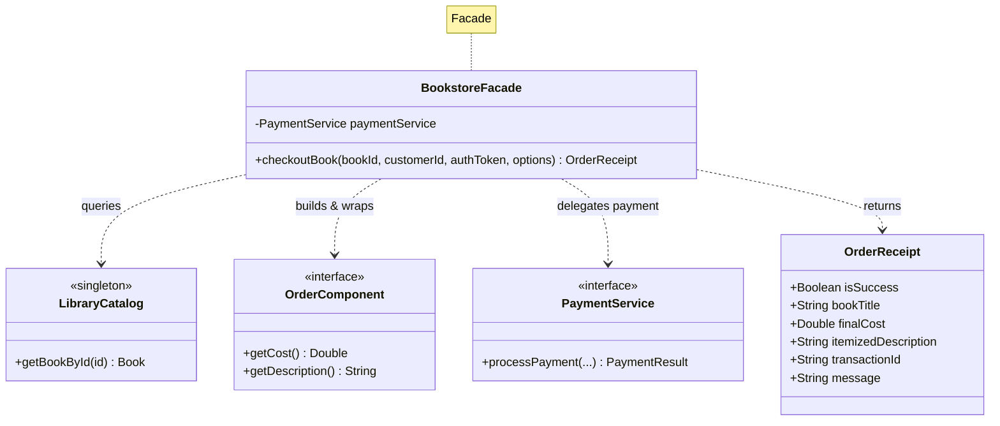

# Laboratory Work 2: Structural Design Patterns

## 1. Domain Description

The chosen application is an **Online Bookstore & Library System** (persisting the domain established in previous labs). The system manages a catalog of physical books and e-books, allows customers to assemble book orders with various optional add-on services (such as gift wrapping, express courier delivery, and shipping insurance), and verifies customer credentials before delegating transactions to a payment processing service.

In this lab, three structural design patterns are implemented:
- **Decorator**: Dynamically attaches additional responsibilities and fee calculations to book orders in any combination at runtime.
- **Proxy**: Protects the payment subsystem by validating authorization tokens, preventing invalid transactions, and maintaining an audit log before delegating to the real payment processor.
- **Facade**: Provides a simplified, high-level interface (`BookstoreFacade`) that orchestrates catalog lookup, order decoration, and proxy-protected payment in a single execution flow.

---

## 2. Implementation of Structural Patterns

### 2.1 Decorator Pattern

#### a. UML Class Diagram


#### b. Code Snippet
From [`lab2/patterns/decorator/OrderDecorators.kt`](file:///home/ionut/Programming/tmpslabs/lab2/patterns/decorator/OrderDecorators.kt#L3-L28):

```kotlin
abstract class OrderDecorator(protected val decoratedOrder: OrderComponent) : OrderComponent {
    override fun getCost(): Double = decoratedOrder.getCost()
    override fun getDescription(): String = decoratedOrder.getDescription()
}

class GiftWrappingDecorator(decoratedOrder: OrderComponent) : OrderDecorator(decoratedOrder) {
    private val fee = 5.0

    override fun getCost(): Double = decoratedOrder.getCost() + fee
    override fun getDescription(): String = "${decoratedOrder.getDescription()} + Gift Wrapping ($${"%.2f".format(fee)})"
}

class ExpressDeliveryDecorator(decoratedOrder: OrderComponent) : OrderDecorator(decoratedOrder) {
    private val fee = 15.0

    override fun getCost(): Double = decoratedOrder.getCost() + fee
    override fun getDescription(): String = "${decoratedOrder.getDescription()} + Express Delivery ($${"%.2f".format(fee)})"
}

class ShippingInsuranceDecorator(decoratedOrder: OrderComponent) : OrderDecorator(decoratedOrder) {
    private val fee = 3.5

    override fun getCost(): Double = decoratedOrder.getCost() + fee
    override fun getDescription(): String = "${decoratedOrder.getDescription()} + Shipping Insurance ($${"%.2f".format(fee)})"
}
```

*Explanation:*  
The base `OrderDecorator` implements `OrderComponent` and wraps another `OrderComponent`, delegating default behavior. Concrete decorators override `getCost()` and `getDescription()` to invoke the wrapped object's calculation and add their specific increment, allowing infinite stackability in any arbitrary order at runtime.

#### c. Unit Tests
Defined in [`lab2/test/TestRunner.kt`](file:///home/ionut/Programming/tmpslabs/lab2/test/TestRunner.kt#L45-L75):
1. `testDecoratorsStackInAnyOrderWithIdenticalCost`: Verifies that stacking `Base -> GiftWrap -> Express` vs `Base -> Express -> GiftWrap` yields identical total cost ($55.00) and commutative behavior.
2. `testAllDecoratorsStackedTogether`: Verifies stacking all three decorators (GiftWrap, Express, Insurance) onto a base order computes the exact combined cost ($51.50) and updates the itemized receipt description.

Passing Test Log:
```text
--- 1. DECORATOR PATTERN TESTS ---
Running: testDecoratorsStackInAnyOrderWithIdenticalCost ... [PASSED]
Running: testAllDecoratorsStackedTogether ... [PASSED]
```

---

### 2.2 Proxy Pattern

#### a. UML Class Diagram


#### b. Code Snippet
From [`lab2/patterns/proxy/PaymentServiceProxy.kt`](file:///home/ionut/Programming/tmpslabs/lab2/patterns/proxy/PaymentServiceProxy.kt#L3-L33):

```kotlin
class PaymentServiceProxy(
    private val realService: PaymentService = RealPaymentService()
) : PaymentService {
    private val validTokens = mutableSetOf("AUTH-USER-001", "AUTH-VIP-777", "AUTH-STUDENT-42")
    private val auditLog = mutableListOf<String>()

    fun registerToken(token: String) {
        validTokens.add(token)
    }

    fun getAuditLog(): List<String> = auditLog.toList()

    override fun processPayment(customerId: String, amount: Double, authToken: String): PaymentResult {
        if (!validTokens.contains(authToken)) {
            val logEntry = "[SECURITY BLOCKED] Unauthorized attempt for customer '$customerId' with invalid token '$authToken'. Amount: $${"%.2f".format(amount)}"
            auditLog.add(logEntry)
            throw SecurityException("Access Denied: Invalid or revoked authentication token '$authToken'.")
        }

        if (amount <= 0.0) {
            val logEntry = "[INVALID AMOUNT] Payment rejected for customer '$customerId': amount must be positive ($amount)."
            auditLog.add(logEntry)
            throw IllegalArgumentException("Payment amount must be greater than zero.")
        }

        val logEntry = "[SECURITY AUTHORIZED] Token verified for customer '$customerId'. Forwarding payment of $${"%.2f".format(amount)} to RealPaymentService."
        auditLog.add(logEntry)
        return realService.processPayment(customerId, amount, authToken)
    }
}
```

*Explanation:*  
`PaymentServiceProxy` implements the exact same `PaymentService` interface as `RealPaymentService`. Before forwarding any call to the underlying service, the proxy performs authorization token verification, guards positive payment invariant bounds, writes to an internal audit trail, and blocks unauthorized requests by throwing a `SecurityException`.

#### c. Unit Tests
Defined in [`lab2/test/TestRunner.kt`](file:///home/ionut/Programming/tmpslabs/lab2/test/TestRunner.kt#L78-L114):
1. `testProxyBlocksUnauthorizedAccess`: Verifies that an invalid token causes the proxy to throw `SecurityException`, does not call the real payment service, and logs the blocked event in `auditLog`.
2. `testProxyAllowsAuthorizedCallsAndPassesThrough`: Verifies that a registered token (`AUTH-USER-001`) passes authorization checks, invokes `RealPaymentService`, returns a valid transaction ID, and logs authorization.

Passing Test Log:
```text
--- 2. PROXY PATTERN TESTS ---
Running: testProxyBlocksUnauthorizedAccess ... [PASSED]
Running: testProxyAllowsAuthorizedCallsAndPassesThrough ... [PASSED]
```

---

### 2.3 Facade Pattern

#### a. UML Class Diagram


#### b. Code Snippet
From [`lab2/patterns/facade/BookstoreFacade.kt`](file:///home/ionut/Programming/tmpslabs/lab2/patterns/facade/BookstoreFacade.kt#L23-L77):

```kotlin
class BookstoreFacade(
    private val paymentService: PaymentService = PaymentServiceProxy()
) {
    fun checkoutBook(
        bookId: String,
        customerId: String,
        authToken: String,
        options: CheckoutOptions = CheckoutOptions()
    ): OrderReceipt {
        val book = LibraryCatalog.getBookById(bookId)
            ?: return OrderReceipt(
                isSuccess = false,
                bookTitle = "Unknown",
                finalCost = 0.0,
                itemizedDescription = "N/A",
                transactionId = null,
                message = "Book with ID '$bookId' not found in library catalog."
            )

        // 1. Construct base component and conditionally decorate
        var order: OrderComponent = BaseOrder(book)
        if (options.includeGiftWrapping) order = GiftWrappingDecorator(order)
        if (options.includeExpressDelivery) order = ExpressDeliveryDecorator(order)
        if (options.includeInsurance) order = ShippingInsuranceDecorator(order)

        val totalCost = order.getCost()
        val description = order.getDescription()

        // 2. Delegate to Payment Proxy
        return try {
            val paymentResult = paymentService.processPayment(customerId, totalCost, authToken)
            OrderReceipt(
                isSuccess = true,
                bookTitle = book.title,
                finalCost = totalCost,
                itemizedDescription = description,
                transactionId = paymentResult.transactionId,
                message = paymentResult.message
            )
        } catch (e: SecurityException) {
            OrderReceipt(
                isSuccess = false,
                bookTitle = book.title,
                finalCost = totalCost,
                itemizedDescription = description,
                transactionId = null,
                message = "Security Proxy Blocked: ${e.message}"
            )
        }
    }
}
```

*Explanation:*  
`BookstoreFacade` hides the multi-step complexity of catalog lookups, decorator pipeline construction, and proxy payment delegation behind a single straightforward method `checkoutBook()`. Client code does not need to know how the subsystem classes instantiate, wrap, or coordinate with one another.

#### c. Unit Tests
Defined in [`lab2/test/TestRunner.kt`](file:///home/ionut/Programming/tmpslabs/lab2/test/TestRunner.kt#L117-L162):
1. `testFacadeExecutesCoordinatedCheckoutSuccessfully`: Verifies the full execution pipeline: catalog lookup, decorator wrapping ($35 base + $5 gift + $15 express = $55), and proxy payment approval.
2. `testFacadeGracefullyHandlesSecurityProxyBlock`: Verifies that when the security proxy rejects an unauthorized token, the facade catches the `SecurityException` and returns a cleanly structured failed `OrderReceipt` rather than crashing.
3. `testFacadeHandlesNonExistentBook`: Verifies that looking up an invalid book ID returns a graceful error receipt.

Passing Test Log:
```text
--- 3. FACADE PATTERN TESTS ---
Running: testFacadeExecutesCoordinatedCheckoutSuccessfully ... [PASSED]
Running: testFacadeGracefullyHandlesSecurityProxyBlock ... [PASSED]
Running: testFacadeHandlesNonExistentBook ... [PASSED]
```

---

## 3. Interaction Between Patterns

The application satisfies the interaction requirement via the following execution path:

```
Client Code (Main.kt)
         │
         ▼
[Facade] BookstoreFacade.checkoutBook()
         │
         ├─► [Creational/Singleton] LibraryCatalog.getBookById()
         │
         ├─► [Decorator] BaseOrder wrapped by GiftWrappingDecorator, ExpressDeliveryDecorator
         │
         └─► [Proxy] PaymentServiceProxy.processPayment()
                   │
                   ▼ (if authorized)
             [RealSubject] RealPaymentService.processPayment()
```

---

## 4. Study Guide: The Remaining Structural Patterns (Defense Reference)

As required by the syllabus, here is the reference breakdown of the other 4 structural design patterns from the list:

### 1. Adapter
* **Intent:** Converts the interface of an existing class into another interface that clients expect.
* **When to use in Bookstore:** If we integrate an external third-party shipping API (e.g. `FedExService` with `shipParcel(weightPounds, postalCode)`) into our bookstore's internal `ShippingProvider` interface (`dispatchOrder(weightKg, address)`).
* **Common Mistake:** Adapting a class you wrote yourself. The Adaptee must represent an existing or external library that you cannot alter.

### 2. Bridge
* **Intent:** Decouples an abstraction from its implementation so that both can vary independently.
* **When to use in Bookstore:** If we have different receipt formats (`DetailedReceipt`, `ShortReceipt`) as the Abstraction, and different rendering implementations (`ConsoleRenderer`, `PdfRenderer`, `HtmlRenderer`) as the Implementor.
* **Common Mistake:** Having only one implementation on either side, which makes the bridge redundant.

### 3. Composite
* **Intent:** Composes objects into tree structures to represent part-whole hierarchies; lets clients treat individual objects and compositions uniformly.
* **When to use in Bookstore:** A `BookItem` (leaf) and a `BookBundle` or `BoxSet` (composite containing multiple books) both implement `CatalogItem` with `getPrice()` and `printDetails()`.
* **Common Mistake:** Giving the leaf and the composite different interfaces, forcing client code to use `instanceof` or type checks.

### 4. Flyweight
* **Intent:** Minimizes memory usage by sharing common, immutable intrinsic state among a large number of fine-grained objects.
* **When to use in Bookstore:** If rendering 100,000 book search results, sharing common `Publisher` or `Genre` metadata objects instead of re-instantiating them for each book.
* **Common Mistake:** Putting mutable state inside the flyweight object instead of passing it as extrinsic state from the client.

---

## 5. Conclusions

In this laboratory work, three structural patterns were implemented in Kotlin to address structural composition, security, and subsystem access:
- **Decorator** eliminated subclass explosion by allowing order add-ons to be dynamically attached and stacked at runtime.
- **Proxy** cleanly isolated cross-cutting concerns (token authentication, boundary checks, and audit logging) without polluting the core payment processor.
- **Facade** drastically simplified the client experience, combining catalog queries, decoration pipelines, and proxy security behind a clean unified API.

### Challenges and Future Considerations
- **What was harder than expected:** Ensuring decorators remained purely commutative and stateless so that wrapping order did not affect the numerical pricing accuracy.
- **What to design differently:** In a production system, rather than passing primitive boolean flags to the facade, a dedicated `CheckoutSpecification` or command object would allow even more flexible combinations of decorators.
