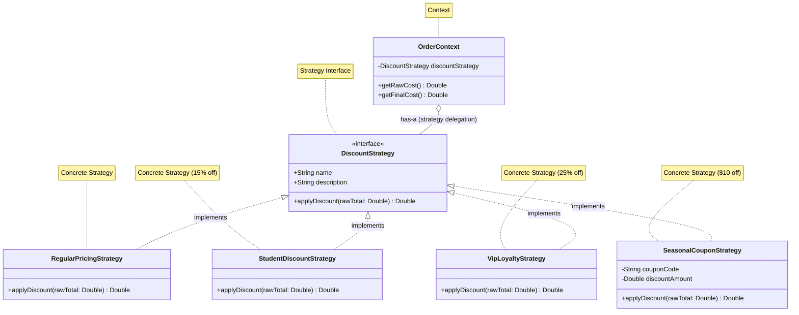
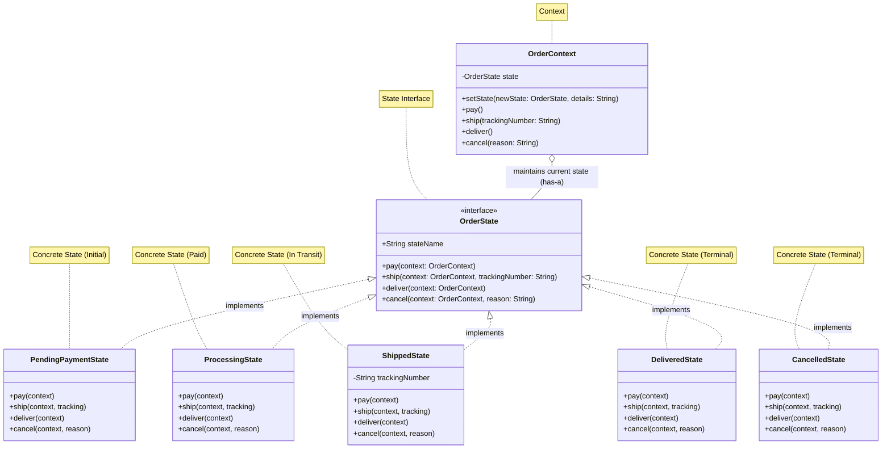
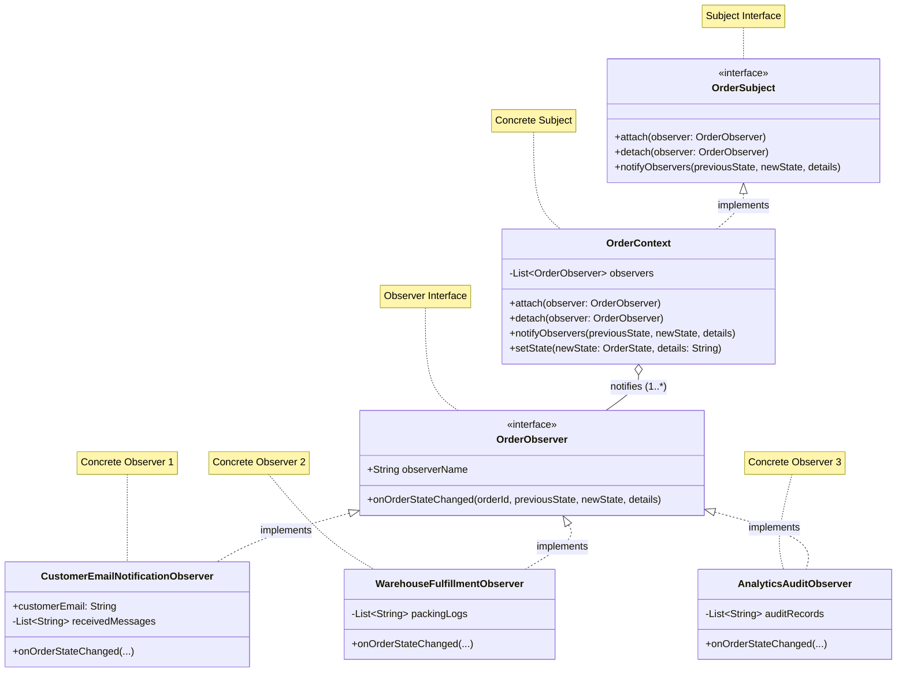
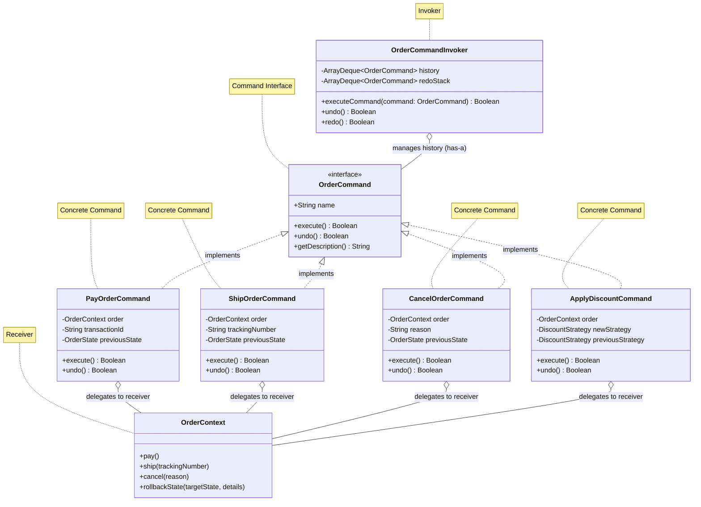

# Laboratory Work 3: Behavioral Design Patterns

## 1. Domain Description

The chosen application is an **Online Bookstore & Library System**, continuing and extending the domain established in previous laboratories (Lab 1: Creational Patterns, Lab 2: Structural Patterns). The system enables customers to browse a catalog of physical books and e-books, customize book orders with optional decorators (gift wrapping, express delivery, shipping insurance), apply various discount pricing strategies, track an order through its complete fulfillment lifecycle, broadcast real-time events across auxiliary services, and manage operations through an undoable command invoker.

In this laboratory work, four behavioral design patterns are implemented:
- **Strategy**: Defines interchangeable pricing and discount algorithms (`RegularPricingStrategy`, `StudentDiscountStrategy`, `VipLoyaltyStrategy`, `SeasonalCouponStrategy`) that can be swapped dynamically at runtime without modifying client code or order representations.
- **State**: Encapsulates the order fulfillment lifecycle (`PendingPaymentState`, `ProcessingState`, `ShippedState`, `DeliveredState`, `CancelledState`), allowing the order context to alter its behavior and enforce domain invariants as its internal state progresses.
- **Observer**: Establishes a publish-subscribe mechanism allowing decoupled subsystems (`CustomerEmailNotificationObserver`, `WarehouseFulfillmentObserver`, `AnalyticsAuditObserver`) to react automatically to order state transitions with full runtime attach/detach capabilities.
- **Command**: Encapsulates state transitions and discount applications into standalone command objects (`PayOrderCommand`, `ShipOrderCommand`, `CancelOrderCommand`, `ApplyDiscountCommand`), paired with an `OrderCommandInvoker` providing transaction history, undo, and redo capabilities.

---

## 2. Implementation of Behavioral Patterns

### 2.1 Strategy Pattern

#### a. UML Class Diagram


#### b. Code Snippet
From [`lab3/patterns/strategy/DiscountStrategy.kt`](file:///home/ionut/Programming/tmpslabs/lab3/patterns/strategy/DiscountStrategy.kt#L7-L44):

```kotlin
interface DiscountStrategy {
    val name: String
    val description: String
    fun applyDiscount(rawTotal: Double): Double
}

class RegularPricingStrategy : DiscountStrategy {
    override val name: String = "Standard Pricing"
    override val description: String = "Standard retail pricing (no discount applied)."
    override fun applyDiscount(rawTotal: Double): Double = rawTotal
}

class StudentDiscountStrategy : DiscountStrategy {
    override val name: String = "Student Discount (15%)"
    override val description: String = "15% off total order for verified academic accounts."
    override fun applyDiscount(rawTotal: Double): Double = (rawTotal * 0.85).coerceAtLeast(0.0)
}

class VipLoyaltyStrategy : DiscountStrategy {
    override val name: String = "VIP Loyalty Discount (25%)"
    override val description: String = "25% off total order for premium bookstore club members."
    override fun applyDiscount(rawTotal: Double): Double = (rawTotal * 0.75).coerceAtLeast(0.0)
}

class SeasonalCouponStrategy(
    val couponCode: String = "SAVE10",
    val discountAmount: Double = 10.0
) : DiscountStrategy {
    override val name: String = "Seasonal Coupon ($couponCode)"
    override val description: String = "Fixed $${"%.2f".format(discountAmount)} coupon discount."
    override fun applyDiscount(rawTotal: Double): Double = (rawTotal - discountAmount).coerceAtLeast(0.0)
}
```

*Explanation:*  
The `DiscountStrategy` interface abstracts the pricing algorithm. Each concrete strategy encapsulates its mathematical calculation independently, avoiding conditional statements (`if/else` or `switch`) inside `OrderContext`. The context delegates `getFinalCost()` to `discountStrategy.applyDiscount(rawTotal)`, allowing strategies to be substituted dynamically at runtime.

#### c. Unit Tests
Defined in [`lab3/test/TestRunner.kt`](file:///home/ionut/Programming/tmpslabs/lab3/test/TestRunner.kt#L52-L84):
1. `testStrategyCalculatesCorrectDiscounts`: Verifies that each strategy computes expected discounted values from a $100 base cost (Standard: $100.00, Student: $85.00, VIP: $75.00, Coupon: $90.00) and ensures non-negative lower-bound clamping.
2. `testStrategyCanBeSwappedAtRuntime`: Validates that mutating `order.discountStrategy` at runtime immediately recalculates the final order amount without reconstructing the order.

Passing Test Log:
```text
--- 1. STRATEGY PATTERN TESTS ---
Running: testStrategyCalculatesCorrectDiscounts ... [PASSED]
Running: testStrategyCanBeSwappedAtRuntime ... [PASSED]
```

---

### 2.2 State Pattern

#### a. UML Class Diagram


#### b. Code Snippet
From [`lab3/patterns/state/OrderStates.kt`](file:///home/ionut/Programming/tmpslabs/lab3/patterns/state/OrderStates.kt#L6-L56):

```kotlin
class PendingPaymentState : OrderState {
    override val stateName: String = "PENDING_PAYMENT"

    override fun pay(context: OrderContext) {
        context.setState(ProcessingState(), "Payment authorized and verified.")
    }

    override fun ship(context: OrderContext, trackingNumber: String) {
        throw IllegalStateException("Cannot ship order '${context.orderId}': Payment has not been received yet.")
    }

    override fun deliver(context: OrderContext) {
        throw IllegalStateException("Cannot deliver order '${context.orderId}': Order has not been paid or shipped.")
    }

    override fun cancel(context: OrderContext, reason: String) {
        context.cancellationReason = reason
        context.setState(CancelledState(), "Cancelled prior to payment: $reason")
    }
}

class ProcessingState : OrderState {
    override val stateName: String = "PROCESSING"

    override fun pay(context: OrderContext) {
        throw IllegalStateException("Cannot pay for order '${context.orderId}': Payment has already been completed.")
    }

    override fun ship(context: OrderContext, trackingNumber: String) {
        if (trackingNumber.isBlank()) throw IllegalArgumentException("Tracking number cannot be blank.")
        context.trackingNumber = trackingNumber
        context.setState(ShippedState(trackingNumber), "Handed over to carrier. Tracking: $trackingNumber")
    }

    override fun cancel(context: OrderContext, reason: String) {
        context.cancellationReason = reason
        context.setState(CancelledState(), "Cancelled during warehouse processing. Refund initiated: $reason")
    }
}
```

*Explanation:*  
Rather than scattering state flags and large `switch` statements across client code, each state object encapsulates its own transition rules. Valid transitions trigger `context.setState(...)`, whereas invalid operations (such as shipping an unpaid order or cancelling an in-transit parcel) throw an `IllegalStateException`, preserving domain integrity.

#### c. Unit Tests
Defined in [`lab3/test/TestRunner.kt`](file:///home/ionut/Programming/tmpslabs/lab3/test/TestRunner.kt#L87-L146):
1. `testValidStateTransitions`: Validates sequential progress through the complete valid order lifecycle: `PENDING_PAYMENT` -> `PROCESSING` -> `SHIPPED` -> `DELIVERED`.
2. `testForbiddenStateTransitionsThrowExceptions`: Proves that invalid transitions (shipping an unpaid order, delivering before shipping, double-paying) are blocked by throwing `IllegalStateException`.
3. `testCannotCancelShippedOrDeliveredOrder`: Proves that once an order is shipped or delivered, cancellation attempts are strictly rejected.

Passing Test Log:
```text
--- 2. STATE PATTERN TESTS ---
Running: testValidStateTransitions ... [PASSED]
Running: testForbiddenStateTransitionsThrowExceptions ... [PASSED]
Running: testCannotCancelShippedOrDeliveredOrder ... [PASSED]
```

---

### 2.3 Observer Pattern

#### a. UML Class Diagram


#### b. Code Snippet
From [`lab3/patterns/observer/ConcreteObservers.kt`](file:///home/ionut/Programming/tmpslabs/lab3/patterns/observer/ConcreteObservers.kt#L6-L45):

```kotlin
class CustomerEmailNotificationObserver(val customerEmail: String) : OrderObserver {
    override val observerName: String = "Customer Email Notification ($customerEmail)"
    private val receivedMessages = mutableListOf<String>()

    fun getReceivedMessages(): List<String> = receivedMessages.toList()

    override fun onOrderStateChanged(orderId: String, previousState: String, newState: String, details: String) {
        val message = "[EMAIL to $customerEmail] Order '$orderId' changed: $previousState -> $newState. Notes: $details"
        receivedMessages.add(message)
    }
}

class WarehouseFulfillmentObserver : OrderObserver {
    override val observerName: String = "Warehouse Logistics & Fulfillment"
    private val packingLogs = mutableListOf<String>()

    fun getPackingLogs(): List<String> = packingLogs.toList()

    override fun onOrderStateChanged(orderId: String, previousState: String, newState: String, details: String) {
        val action = when (newState) {
            "PROCESSING" -> "[WAREHOUSE ACTION] Order '$orderId' paid. Picking items from shelves and printing shipping label."
            "SHIPPED" -> "[WAREHOUSE ACTION] Order '$orderId' picked up by courier. Tracking details: $details."
            "CANCELLED" -> "[WAREHOUSE ACTION] Order '$orderId' cancelled. Restocking items back to library warehouse."
            else -> "[WAREHOUSE LOG] Order '$orderId' status updated to $newState."
        }
        packingLogs.add(action)
    }
}
```

*Explanation:*  
`OrderContext` implements `OrderSubject`. Whenever `setState()` is invoked, it broadcasts the transition event to all attached `OrderObserver` instances. Concrete observers consume the notification independently without coupling `OrderContext` to external systems like mail servers, fulfillment queues, or analytics loggers.

#### c. Unit Tests
Defined in [`lab3/test/TestRunner.kt`](file:///home/ionut/Programming/tmpslabs/lab3/test/TestRunner.kt#L149-L208):
1. `testAllSubscribedObserversAreNotified`: Verifies that when an order transitions to `PROCESSING`, customer notifications, warehouse pick lists, and analytics records are all populated.
2. `testUnsubscribedObserversDoNotReceiveUpdates`: Proves dynamic subscription: detaching an observer at runtime halts future notifications to that observer while active observers continue receiving them.

Passing Test Log:
```text
--- 3. OBSERVER PATTERN TESTS ---
Running: testAllSubscribedObserversAreNotified ... [PASSED]
Running: testUnsubscribedObserversDoNotReceiveUpdates ... [PASSED]
```

---

### 2.4 Command Pattern

#### a. UML Class Diagram


#### b. Code Snippet
From [`lab3/patterns/command/ConcreteCommands.kt`](file:///home/ionut/Programming/tmpslabs/lab3/patterns/command/ConcreteCommands.kt#L10-L40):

```kotlin
class PayOrderCommand(
    private val order: OrderContext,
    val transactionId: String
) : OrderCommand {
    override val name: String = "PayOrderCommand"
    private var previousState: OrderState? = null

    override fun execute(): Boolean {
        previousState = order.state
        return try {
            order.pay()
            true
        } catch (e: Exception) {
            println("Failed to execute $name: ${e.message}")
            false
        }
    }

    override fun undo(): Boolean {
        val prevState = previousState ?: return false
        order.rollbackState(prevState, "Payment rolled back/refunded for txn $transactionId.")
        return true
    }

    override fun getDescription(): String = 
        "Pay order '${order.orderId}' (Txn: $transactionId, Amount: $${"%.2f".format(order.getFinalCost())})"
}
```

*Explanation:*  
The command object encapsulates the request to pay an order, retaining a reference to the receiver (`OrderContext`) and saving the pre-execution snapshot (`previousState`). When `undo()` is invoked by `OrderCommandInvoker`, the command restores the receiver's state, cleanly separating invocation from execution.

#### c. Unit Tests
Defined in [`lab3/test/TestRunner.kt`](file:///home/ionut/Programming/tmpslabs/lab3/test/TestRunner.kt#L211-L253):
1. `testCommandExecutionAndUndoRestoresState`: Executes `PayOrderCommand`, transitions the order to `PROCESSING`, and asserts that invoking `invoker.undo()` rolls back the state to `PENDING_PAYMENT`.
2. `testCommandRedoAndApplyDiscountUndo`: Proves undo and redo symmetry on `ApplyDiscountCommand`, showing that discounts can be applied, rolled back to regular price, and reapplied via redo.

Passing Test Log:
```text
--- 4. COMMAND PATTERN TESTS ---
Running: testCommandExecutionAndUndoRestoresState ... [PASSED]
Running: testCommandRedoAndApplyDiscountUndo ... [PASSED]
```

---

## 3. Interaction Between Patterns

The application satisfies the pattern interaction requirement through a coordinated workflow where each pattern fulfills a distinct behavioral responsibility without tight coupling:

```
                  Client Action (Main / CLI)
                             │
                             ▼
               [Command Pattern] OrderCommandInvoker
                             │
            ┌────────────────┴────────────────┐
            ▼                                 ▼
   ApplyDiscountCommand                 PayOrderCommand
            │                                 │
            ▼                                 ▼
[Strategy Pattern]                     [Receiver / Context]
DiscountStrategy.applyDiscount()       OrderContext.pay()
(swaps algorithm at runtime)                  │
                                              ▼
                                    [State Pattern]
                                    PendingPaymentState.pay()
                                              │
                                              ▼ transitions to
                                    ProcessingState
                                              │
                                              ▼ triggers
                                    OrderContext.setState()
                                              │
                                              ▼ publishes event
                                    [Observer Pattern]
                        ┌─────────────────────┼─────────────────────┐
                        ▼                     ▼                     ▼
              CustomerEmailObserver   WarehouseObserver     AnalyticsObserver
              (dispatches receipt)    (generates pick-list) (logs audit trail)
```

### Execution Flow Step-by-Step:
1. **Creational & Structural Foundation**: The client retrieves a `Book` from the `LibraryCatalog` singleton and dynamically decorates it with `GiftWrappingDecorator` and `ExpressDeliveryDecorator`.
2. **Strategy**: The client attaches a `DiscountStrategy` (e.g., `StudentDiscountStrategy`) to the `OrderContext` via an `ApplyDiscountCommand`.
3. **Command & Invoker**: The client submits a `PayOrderCommand` to the `OrderCommandInvoker`.
4. **State**: The command delegates execution to the receiver `OrderContext.pay()`. The current state (`PendingPaymentState`) validates the operation and transitions the context to `ProcessingState`.
5. **Observer**: Upon transition, `OrderContext` broadcasts the state change to all attached observers (`CustomerEmailNotificationObserver`, `WarehouseFulfillmentObserver`, `AnalyticsAuditObserver`).
6. **Undo Capability**: If the transaction is revoked via `invoker.undo()`, the command rolls back the state to `PendingPaymentState`, which in turn triggers a rollback notification to all observers.

Passing Interaction & Extension Test Logs:
```text
--- 5. PATTERN INTERACTION TEST ---
Running: testIntegratedWorkflowStrategyCommandStateObserver ... [PASSED]

--- 6. OPEN-CLOSED PRINCIPLE EXTENSION TEST ---
Running: testOpenForExtensionAllowsNewObserverAndStrategyWithoutModifyingExistingCode ... [PASSED]

==================================================
TEST SUMMARY: 11 passed, 0 failed out of 11 total.
==================================================
```

---

## 4. Study Guide: The Remaining Behavioral Patterns (Defense Reference)

As required by the syllabus, the following section provides a concrete study guide and defense reference for the remaining behavioral design patterns from the GoF catalog:

### 1. Chain of Responsibility
* **Intent:** Passes a request along a chain of handlers until one of them processes it, avoiding coupling the sender to a concrete receiver.
* **When to use in Bookstore:** Order validation pipeline prior to checkout: `StockAvailabilityHandler` -> `CreditLimitHandler` -> `FraudDetectionHandler` -> `TaxCalculationHandler`.
* **Common Mistake:** Hardcoding chain ordering inside handler implementations, calling concrete handlers directly from client code, or letting a request fall off the end of the chain with no defined fallback result.

### 2. Iterator
* **Intent:** Provides a way to access the elements of an aggregate object sequentially without exposing its underlying internal representation (tree, hash table, or array).
* **When to use in Bookstore:** Traversing a book catalog by different traversal criteria: `GenreFilteredIterator`, `BestSellerRankingIterator`, or `AlphabeticalAuthorIterator`.
* **Common Mistake:** Returning the internal collection reference directly instead of a standalone traversal object, or wrapping a trivial language-level `for` loop with no custom traversal logic.

### 3. Mediator
* **Intent:** Defines an object that encapsulates how a set of objects interact, preventing colleagues from referring to each other directly and promoting loose coupling.
* **When to use in Bookstore:** A `CheckoutDialogMediator` coordinating interactive UI components: when the "Express Delivery" checkbox is clicked, the mediator updates the total price label, enables the courier selection dropdown, and refreshes the tax estimate.
* **Common Mistake:** Turning the mediator into an unmaintainable "god class" that holds all subsystem business logic, or allowing colleague components to bypass the mediator and reference each other directly.

### 4. Memento
* **Intent:** Captures and externalizes an object's internal state without violating encapsulation, allowing the object to be restored to that state later.
* **When to use in Bookstore:** Shopping cart checkpointing or draft order restoration: saving a `CartMemento` snapshot before applying speculative promotional coupons so the user can roll back if dissatisfied.
* **Common Mistake:** Exposing the originator's private fields publicly inside the memento, or storing mutable object references in the snapshot that can be modified after the snapshot is taken.

### 5. Template Method
* **Intent:** Defines the skeleton of an algorithm in a superclass method, letting subclasses override specific steps without changing the overall algorithm structure.
* **When to use in Bookstore:** An `OrderInvoiceGenerator` base class with template method `generateInvoice()`:
  1. `fetchOrderData()` (shared)
  2. `formatHeader()` (shared)
  3. `formatBody()` (abstract: `PdfInvoiceGenerator` vs `HtmlInvoiceGenerator` vs `ConsoleInvoiceGenerator`)
  4. `computeTaxSummary()` (shared)
  5. `exportDocument()` (abstract)
* **Common Mistake:** Allowing subclasses to override the template method itself (not marking it `final`), altering execution order, or failing to share actual algorithmic steps.

### 6. Visitor
* **Intent:** Represents an operation to be performed on the elements of an object structure, letting you define new operations without changing the classes of the elements on which it operates.
* **When to use in Bookstore:** Applying export operations across varied catalog items (`PhysicalBook`, `EBook`, `AudioBook`, `BookBundle`): an `XmlExportVisitor`, `JsonExportVisitor`, or `InventoryValuationVisitor` using double dispatch (`element.accept(visitor)` -> `visitor.visit(this)`).
* **Common Mistake:** Using `instanceof` or reflection checks instead of double dispatch (`accept`/`visit`), or applying the pattern to an element class hierarchy that changes frequently.

### 7. Interpreter (Good to Know)
* **Intent:** Given a language, defines a grammar representation along with an interpreter that uses the representation to interpret sentences in the language.
* **When to use in Bookstore:** A custom search query language for catalog filtering: parsing and evaluating query expressions such as `genre = 'SciFi' AND (price < 30 OR author = 'Asimov')`.
* **Common Mistake:** Using Interpreter for complex grammars where a dedicated parser generator (like ANTLR) is required, resulting in deep, inefficient syntax trees.

---

## 5. Conclusions

In this laboratory work, four behavioral design patterns (**Strategy**, **State**, **Observer**, and **Command**) were successfully designed and implemented in Kotlin within the **Online Bookstore & Library System**:
- **Strategy** cleanly isolated pricing variations, eliminating monolithic conditional logic and making discount calculations open for extension.
- **State** replaced messy status conditionals and scattered flags with cohesive state classes that strictly enforce valid lifecycle transitions.
- **Observer** established complete decoupling between core order management and auxiliary notification/audit/logistics subscribers.
- **Command** transformed actions into first-class objects, enabling structured queuing, transaction logging, and robust undo/redo capabilities.

### Challenges and Design Considerations
- **What was harder than expected:** Balancing state rollback logic in the Command pattern while keeping observers synchronized. If a command is undone, the rollback must announce the state change cleanly without triggering infinite notification loops.
- **What to design differently:** In a distributed production microservices architecture, observer notifications would be backed by an event bus (e.g., Apache Kafka or RabbitMQ) with persistent outbox messaging, ensuring guaranteed at-least-once delivery across network boundaries.
